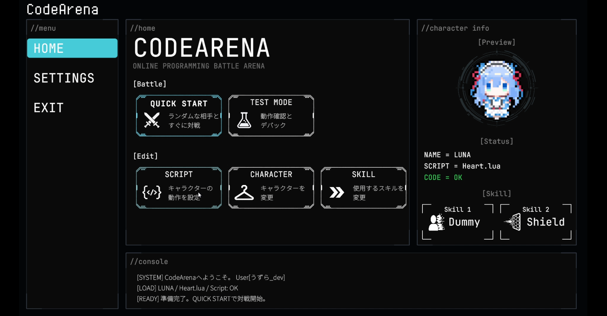

# CodeArena スクリプトドキュメント

CodeArenaでは、Luaスクリプトでキャラクターの行動や弾の制御を記述します。
最初のスクリプトを動かすところから、戦術や独創的な動きを作り込むためのAPIまで紹介します。

## 始め方
### ■キャラクター選択
HOMEからキャラクター変更画面へ移動

 3人のキャラクターから選択し、Selectボタンを押す

 キャラクターによってわずかにステータス差があります。
あなたの戦い方に合ったキャラクターを選びましょう。

### ■スクリプト選択
キャラクターの動作は**Lua**というプログラミング言語で構成されています。
最初からプログラミングを知る必要は全くありません。まずはサンプルから選んでみましょう。
まずははBasic.Luaを選択してスクリプトをセットしましょう。基本的な戦闘が可能です。
他にも多数のサンプルを用意しています。

コード例：

### ■スキル選択
プレイヤーは2つのスキルを装備でき、ゲーム中の任意のタイミングで発動できます。
スキルを使用すれば対戦で有利な状況を作り出すことができます。
スキル使用後は一定時間のクールダウンを持っています。

### ■動作確認
新しく使用するスクリプトや改造したスクリプトが正しく動くか動作確認をしましょう。
相手はプレイヤーではなく、ダミーNPCになります。

### ■ゲーム開始
QUICK STARTボタンを押すと、待機中のプレイヤーとランダムにマッチングしてゲームを開始します。

### ■ゲームルール
ゲームは3ラウンド制。
敵のHPを0にするか時間切れ時に体力が多い方がそのマッチのポイントを取ります。

#### HEATゲージについて：

#### OVER HEAT(オーバーヒート状態)について：
弾を発射すると、HPゲージ下のHeatゲージが上昇します。時間経過で低下していきますが、弾を連続で撃ちすぎると閾値を超えて**オーバーヒート状態**になります。
**オーバーヒート状態**では移動速度/弾速/発射レート等の基本性能が低下します。弾の発射を控え、冷却を待ちましょう。

#### OVER CLOCK(オーバークロック状態)について：
一定時間ごとにマップ中央にアイテムが出現します。アイテムは耐久値を持っており、弾で壊してから拾うことができます。
3つ集めると任意のタイミングで**オーバークロック状態**に入ることができます。**オーバークロック状態**ではHeatゲージの上限値が上昇し、移動速度/弾速/発射レート等の基本性能が一定時間大幅に向上します。これはかなり強力なシステムであり、戦況を大幅に変えることが可能です。

## 初めてスクリプトを作る方へ

[スクリプト作成ガイド](https://uzurann.github.io/CodeArena-Docs/getting-started.html)

画面の開き方、エディターの操作、最小サンプル、保存・使用設定、動作確認の順に進めます。

## 関数の使い方を調べたい方へ

[Lua APIリファレンス](https://uzurann.github.io/CodeArena-Docs/lua-api.html)

`Start()`・`Update()`・`state`の仕組み、各API、実行制限やエラーを確認できます。

## サンプルについて

作成ガイドに移動・ジャンプの最小サンプルを掲載しています。
射撃、弾制御、スキル、作品づくりのサンプルは今後追加予定です。
各サンプルには目的、変更して試せる値、期待する動作、対応ビルドを記載します。

## 変更履歴

| 日付 | 対応ビルド | 内容 |
| --- | --- | --- |
| 2026-10-26 | 未指定 | トップ・作成ガイド・APIリファレンスの3ページに再構成 |
| 2026-10-26 | 未指定 | 実装からAPI一覧と基本制約の骨格を作成 |
